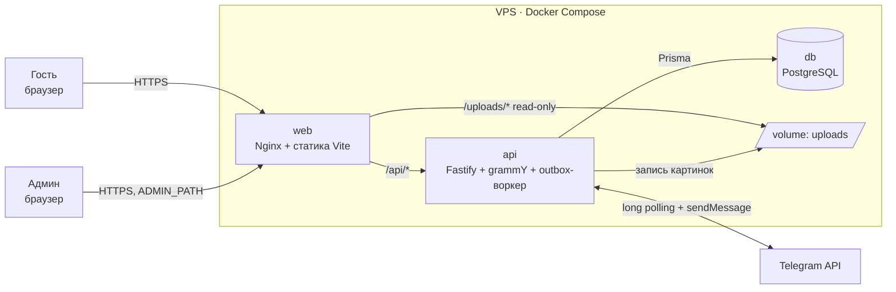
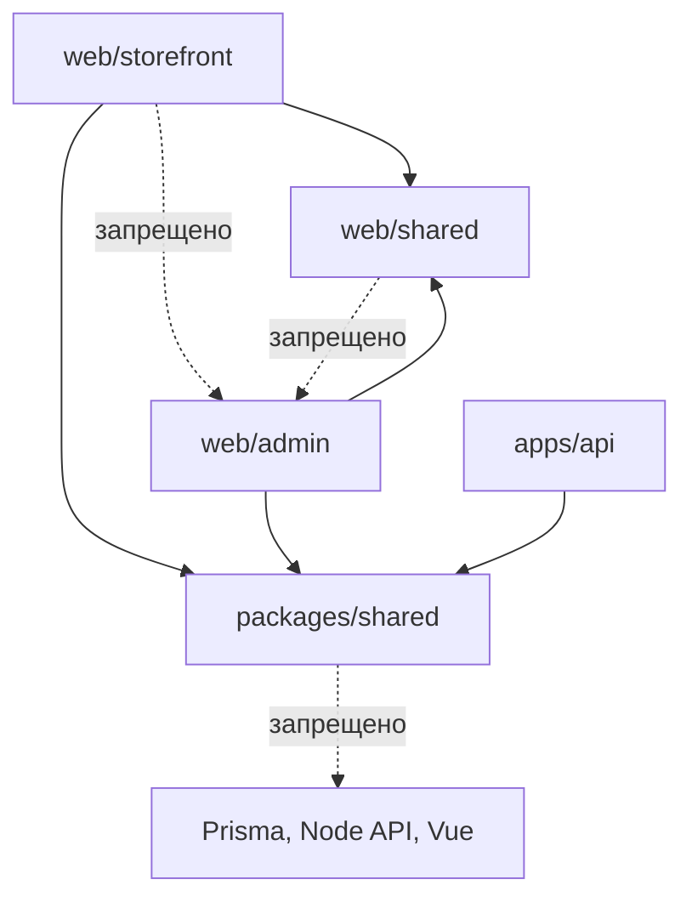
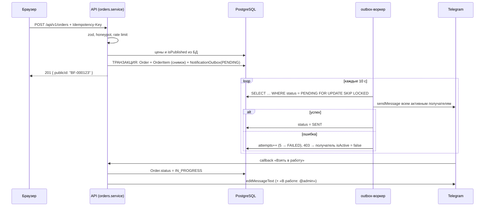

# Архитектура BotForge (MVP)

Документ описывает, как устроен код BotForge: где что лежит, как части связаны между собой и как всё это попадает на сервер. Основа — [ТЗ v4](TZ-BotForge-MVP.md).

Главный принцип: **один репозиторий, три контейнера, один процесс бэкенда**. Масштаб заложен точками расширения (они перечислены в разделе 10), но в MVP ничего из этого не включено.

---

## 1. Обзор системы



| Контейнер | Что внутри | Порты наружу |
|---|---|---|
| `web` | Nginx: TLS, статика витрины и админки, прокси `/api` → `api`, раздача `/uploads` | 80, 443 |
| `api` | Node.js: REST API, Telegram-бот (grammY), фоновый воркер outbox | нет (только внутренняя сеть) |
| `db` | PostgreSQL 16 | нет |
| `certbot` | Выпуск и продление сертификатов Let's Encrypt (запускается по требованию) | нет |

**Почему так:**

- Nginx — единственная точка входа. API и БД не торчат в интернет, поэтому не нужен CORS (фронт и API на одном домене) и cookie `SameSite=Lax` работает без исключений.
- Бот и воркер живут в процессе API, как требует ТЗ: для одной студии отдельные сервисы — лишняя инфраструктура. Разделить их можно одной переменной окружения (раздел 10).
- Статика отдаётся Nginx, а не Node: так быстрее и проще кешировать.

---

## 2. Структура репозитория

Монорепозиторий на **npm workspaces** (встроены в npm, дополнительных инструментов не нужно).

```
botforge/
├── apps/
│   ├── web/                        # Фронтенд: витрина + админка (один Vite-проект, две точки входа)
│   │   ├── index.html              # Точка входа витрины
│   │   ├── admin.html              # Точка входа админки (noindex)
│   │   ├── public/                 # favicon, robots.txt (без упоминания админки)
│   │   ├── src/
│   │   │   ├── storefront/         # Витрина — попадает только в бандл index.html
│   │   │   │   ├── main.ts
│   │   │   │   ├── App.vue
│   │   │   │   ├── router.ts
│   │   │   │   ├── pages/          # HomePage, ProductPage, AboutPage, CheckoutPage, OrderSuccessPage, NotFoundPage, PrivacyPage
│   │   │   │   ├── components/     # catalog/, product/, cart/ (CartDrawer, CartItem), layout/ (Header, Footer)
│   │   │   │   ├── stores/         # cart.ts (Pinia + localStorage `cart:v1`), store-settings.ts
│   │   │   │   ├── composables/    # useCatalogQuery, useDebouncedRef, useSeo
│   │   │   │   └── api/            # catalog.ts, cart.ts, orders.ts, store.ts — типизированные вызовы
│   │   │   ├── admin/              # Админка — попадает только в бандл admin.html
│   │   │   │   ├── main.ts
│   │   │   │   ├── App.vue
│   │   │   │   ├── router.ts       # hash-история, см. раздел 5.3
│   │   │   │   ├── pages/          # LoginPage, orders/, products/, categories/, StorePage, SettingsPage
│   │   │   │   ├── components/     # ProductForm, ImageUploader, MarkdownEditor, OrderStatusBadge…
│   │   │   │   ├── stores/         # auth.ts, unread-orders.ts (поллинг 30 с)
│   │   │   │   └── api/            # products.ts, orders.ts, telegram.ts…
│   │   │   ├── shared/             # Общее для витрины и админки (не содержит ничего «секретного»)
│   │   │   │   ├── http.ts         # fetch-обёртка: /api/v1, credentials, разбор { code, message, fields }
│   │   │   │   ├── ui/             # Button, Modal, Toast, Skeleton, Drawer — базовые компоненты
│   │   │   │   └── utils/          # markdown.ts (marked + DOMPurify), focus-trap и т.п.
│   │   │   └── styles/
│   │   │       ├── main.css        # Tailwind v4: @import "tailwindcss" + @import "./theme.css"
│   │   │       └── theme.css       # @theme, генерируется из DESIGN.md (см. 5.5), руками не правится
│   │   ├── vite.config.ts          # rollupOptions.input: { index, admin }, proxy /api → :3000, плагин @tailwindcss/vite
│   │   └── package.json
│   │
│   └── api/                        # Бэкенд
│       ├── prisma/
│       │   ├── schema.prisma
│       │   ├── migrations/
│       │   └── seed.ts             # 12 товаров, 4 категории, пустые StoreSettings
│       ├── src/
│       │   ├── main.ts             # Точка входа: config → app → bot → workers → listen; graceful shutdown
│       │   ├── app.ts              # Сборка Fastify: плагины + модули (без listen — удобно для тестов)
│       │   ├── config.ts           # Чтение и zod-валидация process.env; падаем на старте, если чего-то нет
│       │   ├── plugins/            # Сквозная инфраструктура
│       │   │   ├── prisma.ts       # Один PrismaClient на процесс
│       │   │   ├── errors.ts       # AppError → { code, message, fields? }, ZodError → 422
│       │   │   ├── security.ts     # helmet, проверка Origin на POST/PUT/PATCH/DELETE
│       │   │   ├── rate-limit.ts
│       │   │   └── auth.ts         # Чтение cookie `sid`, request.admin, хук requireAdmin
│       │   ├── modules/            # Бизнес-модули: каждый = routes + service
│       │   │   ├── catalog/        # GET /products, /products/:slug, /categories
│       │   │   ├── cart/           # POST /cart/preview
│       │   │   ├── orders/         # POST /orders (публичный) + admin/orders
│       │   │   ├── store/          # GET /store + PUT /admin/store
│       │   │   ├── auth/           # login/logout/me, сессии, LoginAttempt, блокировка
│       │   │   ├── admin-products/ # CRUD товаров
│       │   │   ├── admin-categories/
│       │   │   ├── uploads/        # Проверка сигнатуры, sharp → WebP, запись в UPLOADS_DIR
│       │   │   └── telegram/       # Привязка получателей, тест, список
│       │   ├── bot/                # grammY: /start <token>, callback «Взять в работу»
│       │   │   ├── bot.ts
│       │   │   └── messages.ts     # Форматирование текста уведомлений
│       │   ├── workers/
│       │   │   └── outbox.ts       # Раз в 10 с: PENDING → отправка → SENT/FAILED
│       │   ├── cli/                # admin-create.ts, admin-reset-password.ts (интерактивный ввод)
│       │   └── lib/                # password.ts (argon2id), tokens.ts, order-number.ts, slugify.ts
│       ├── test/                   # vitest: orders.service, auth.service
│       ├── tsdown.config.ts        # Прод-сборка в один бандл, встраивает @botforge/shared (см. 2.3)
│       └── package.json
│
├── packages/
│   └── shared/                     # Код, общий для фронта и бэка
│       ├── src/
│       │   ├── schemas/            # zod: order.ts, product.ts, category.ts, store.ts, cart.ts
│       │   ├── constants.ts        # Лимиты: 1–99 шт., 50 позиций, 6 картинок, 5 МБ…
│       │   ├── enums.ts            # PriceType, OrderStatus, PreferredContact + разрешённые переходы статусов
│       │   ├── money.ts            # formatPrice(kopecks, priceType) → «от 1 500 ₽/час»
│       │   ├── phone.ts            # Нормализация +7…
│       │   └── api-types.ts        # DTO ответов API (ProductCard, ProductDetails, CartPreview…)
│       └── package.json            # name: @botforge/shared, exports → ./src/index.ts, своей сборки нет
│
├── deploy/
│   ├── nginx/
│   │   └── default.conf.template   # Шаблон с ${ADMIN_PATH} и ${DOMAIN}, подставляется при старте
│   ├── web.Dockerfile              # build фронта → образ nginx
│   ├── api.Dockerfile              # build бэка → образ node
│   └── scripts/
│       ├── backup.sh               # pg_dump + архив uploads, хранение 7 дней
│       ├── deploy.sh               # git pull → build → up -d
│       └── init-letsencrypt.sh     # Первичный выпуск сертификата
│
├── docker-compose.yml              # Прод: web, api, db, certbot
├── docker-compose.dev.yml          # Локально: только db (приложения запускаются нативно ради HMR)
├── .env.example                    # Все переменные с пустыми значениями
├── tsconfig.base.json              # strict, общие опции
├── eslint.config.js                # flat config на весь монорепозиторий
├── .prettierrc
├── DESIGN.md                       # Дизайн-система: токены (YAML) + правила применения, см. 5.5
├── package.json                    # workspaces: ["apps/*", "packages/*"], корневые скрипты (dev через concurrently)
└── README.md                       # Запуск: docker compose up, сиды, создание админа
```

### 2.1. Правила зависимостей между частями



| Правило | Зачем |
|---|---|
| `storefront` никогда не импортирует из `admin` | Иначе код админки (и её роуты) попадёт в публичный бандл — ровно то, от чего защищает раздел 5.1 ТЗ |
| `packages/shared` не зависит ни от Prisma, ни от Vue, ни от Node-модулей | Его импортируют и браузер, и сервер. Только zod и чистые функции |
| Фронт не знает про `@prisma/client` | Контракт между фронтом и бэком — DTO из `api-types.ts`, а не модель БД. Можно менять схему, не ломая фронт |
| Модули API общаются через сервисы, а не через HTTP и не через чужие таблицы напрямую | Например, `orders.service` вызывает `catalog.service.getPublishedByIds()`, а не пишет свой запрос к `Product` |

Запрет импортов закрепляется правилом ESLint `no-restricted-imports` — проверяется автоматически, а не на ревью.

### 2.2. Почему один Vite-проект для витрины и админки

ТЗ требует, чтобы админка была второй точкой входа Vite. Один проект с двумя `input` даёт общий Tailwind-конфиг, общие UI-компоненты и одну сборку, но Rollup раскладывает код по разным чанкам: в `index.html` подключаются только чанки витрины и общие (`vue`, `shared/ui`). Отдельный `apps/admin` дал бы ту же изоляцию ценой дублирования конфигов — для MVP это лишнее.

Проверка из критериев приёмки («в JS-бандле витрины нет пути админки») выполняется скриптом после сборки: `grep` по файлам, подключённым в `dist/index.html`. Сам путь в бандл не попадёт никогда — см. 5.3.

### 2.3. Сборка внутри монорепозитория

Голые npm workspaces не умеют две вещи: запускать скрипты пакетов параллельно (`npm run dev --workspaces` выполняет их по очереди, и первый watch-процесс блокирует остальные) и собирать пакеты в порядке зависимостей (`--workspaces` идёт в порядке объявления). Обе проблемы решаются без отдельного оркестратора:

1. **`@botforge/shared` — пакет из исходников, без своей сборки** (в документации Turborepo такой подход называется Just-in-Time internal package). Его `package.json` экспортирует `./src/index.ts`, а TypeScript компилирует тот, кто его импортирует:
   - **web:** Vite сам компилирует TS из workspace-пакетов, подключённых симлинком;
   - **api в dev:** `tsx watch` выполняет TS напрямую, включая импорты из `shared`;
   - **api в prod:** tsdown собирает `src/main.ts` в один бандл. `@botforge/shared` указан в `deps.alwaysBundle` и встраивается в бандл, остальные `dependencies` (Prisma, sharp, argon2) остаются внешними, как и должны.

   Раз собирать `shared` не нужно, исчезает и вопрос порядка сборки: каждое приложение собирается независимо одной командой.
2. **Параллельный dev-запуск** — через `concurrently` в корневом `package.json`: `concurrently -n api,web "npm:dev -w apps/api" "npm:dev -w apps/web"`. Логи обоих процессов идут в один терминал с префиксами, а `Ctrl+C` останавливает оба.

Проверка типов при этом не теряется: `tsc --noEmit` в каждом приложении проверяет и импортируемый код `shared`.

**Почему tsdown, а не tsup.** tsup с 2025 года не развивается, в его README авторы рекомендуют переходить на tsdown (на Rolldown, от команды Vite). Для нашей задачи разница только в названии опции: `deps.alwaysBundle` вместо `noExternal`.

**Почему не Turborepo.** Turborepo — не замена workspaces, а надстройка над ними: граф задач, кеш результатов, `turbo prune --docker`. На трёх пакетах и сборке на VPS его кеш почти ничего не ускоряет, а `turbo.json` — ещё одна сущность. Когда он станет оправдан, указано в разделе 10.

---

## 3. Бэкенд

### 3.1. Фреймворк: Fastify

Из двух вариантов ТЗ выбран **Fastify**: в нём из коробки есть система плагинов с инкапсуляцией (удобно повесить `requireAdmin` на весь префикс `/admin`), быстрый JSON, официальные плагины для всего, что нужно по ТЗ (helmet, cookie, rate-limit, multipart), и интеграция с zod через type provider. В Express то же самое собирается из разрозненных middleware.

### 3.2. Слои внутри модуля

```
HTTP-запрос → routes.ts → service.ts → Prisma → PostgreSQL
               │            │
               │            └─ бизнес-правила, транзакции, бросает AppError
               └─ валидация zod-схемой из @botforge/shared, проверка доступа, маппинг в DTO
```

- **routes** — тонкие: распарсить, проверить, вызвать сервис, вернуть ответ. Ни одного запроса к БД.
- **service** — вся логика: снимок цен, переходы статусов, блокировка входа. Именно сервисы покрываются unit-тестами из ТЗ.
- **Отдельного слоя репозиториев нет.** Prisma уже является типизированным слоем доступа к данным; обёртка над ней в MVP даст только лишний код. Если запросы начнут повторяться — выносятся в функции внутри модуля.

### 3.3. Регистрация маршрутов

```ts
// app.ts — схематично
app.register(publicRoutes, { prefix: '/api/v1' })        // catalog, cart, orders, store, auth
app.register(async (admin) => {
  admin.addHook('preHandler', requireAdmin)               // нет сессии → 401
  admin.register(adminProducts)
  admin.register(adminCategories)
  // …
}, { prefix: '/api/v1/admin' })
app.get('/api/health', healthHandler)                     // SELECT 1 к БД
```

Хук `requireAdmin` висит на всём префиксе, поэтому новый админский маршрут **невозможно** случайно оставить открытым — это прямо закрывает критерий «любой `/admin/*` без входа → 401».

### 3.4. Ошибки

Один класс `AppError(status, code, message, fields?)` и один error handler:

| Источник | Ответ |
|---|---|
| `ZodError` | `422 { code: 'VALIDATION_ERROR', message, fields: { phone: '…' } }` |
| `AppError` | как задан в сервисе (`404 PRODUCT_NOT_FOUND`, `409 CATEGORY_NOT_EMPTY`…) |
| `Prisma P2002` (unique) | `409 CONFLICT` с полем, например `slug` |
| Всё остальное | `500 INTERNAL_ERROR`, детали только в лог |

`message` — на английском (для логов), тексты для пользователя фронт берёт по `code` из своего словаря.

### 3.5. Безопасность в API

| Механизм | Где |
|---|---|
| helmet, CSP | `plugins/security.ts` |
| Проверка `Origin === APP_ORIGIN` на изменяющих запросах | `plugins/security.ts` |
| Сессия: случайный токен в cookie, в БД только его SHA-256 | `modules/auth` |
| argon2id для паролей | `lib/password.ts` |
| Лимит 5 заявок/час с IP | `@fastify/rate-limit` на маршруте `POST /orders` |
| Блокировка входа (5 попыток / 15 мин) | `auth.service` по таблице `LoginAttempt` — переживает перезапуск |
| Реальный IP клиента | Fastify `trustProxy: true`, Nginx передаёт `X-Forwarded-For`. **Без этого все лимиты будут считать IP Nginx** |
| Загрузки: сигнатура файла, ≤ 5 МБ, пересжатие, случайное имя | `modules/uploads` |

### 3.6. Telegram и outbox

Бот работает в режиме **long polling**: не нужен публичный webhook-адрес, бот запускается одинаково локально и на сервере.



Ключевое: заявка и запись outbox создаются **в одной транзакции**. Если Telegram лежит или процесс упал сразу после ответа клиенту, запись `PENDING` останется в БД и будет отправлена после перезапуска — это критерий «при выключенном боте уведомление доходит после запуска».

`FOR UPDATE SKIP LOCKED` в MVP не обязателен (процесс один), но стоит одну строку и заранее защищает от двойной отправки, если воркеров станет больше.

---

## 4. База данных

- **Prisma-схема** — `apps/api/prisma/schema.prisma`, миграции в `prisma/migrations` (коммитятся в git).
- **Деньги** — только целые копейки (`Int`), форматирование — `packages/shared/money.ts`. Никаких float.
- **Номер заявки** `BF-000123` — из автоинкрементного `id` (или отдельной sequence) при создании, а не `count() + 1`: подсчёт даёт дубли при параллельных заявках.
- **Мягкое удаление** товаров (`deletedAt`): все публичные запросы каталога фильтруют `isPublished = true AND deletedAt IS NULL` в одном месте — `catalog.service`.
- **Индексы:** `Product(slug)` unique, `Product(categoryId, isPublished)`, `Order(status, createdAt)`, `Order(publicId)` unique, `NotificationOutbox(status, createdAt)`, `LoginAttempt(ip, createdAt)`, `Session(tokenHash)` unique.

### 4.1. Уточнения к модели данных из ТЗ

Небольшие дополнения, без которых часть требований ТЗ не реализуется:

| Изменение | Зачем |
|---|---|
| `Order.idempotencyKey String? @unique` | ТЗ требует `Idempotency-Key` против двойного клика — ключ нужно где-то хранить. Повторный запрос с тем же ключом возвращает уже созданную заявку |
| `NotificationOutbox`: `type` (`ORDER_CREATED`, `LOGIN_NEW_IP`, `LOGIN_BLOCKED`) + `payload Json`, `orderId` необязателен | ТЗ требует оповещения о входе с нового IP и о подборе пароля. Пусть они идут через тот же надёжный outbox, а не отдельным кодом |
| `OneTimeToken.purpose` — enum | Для будущих целей (2FA через бота из бэклога) без миграции типа поля |

---

## 5. Фронтенд

### 5.1. Общение с API

- Все запросы идут через `web/src/shared/http.ts`: префикс `/api/v1`, `credentials: 'same-origin'`, разбор ошибки в типизированный `ApiError { code, message, fields }`.
- Типы ответов — из `@botforge/shared/api-types`, схемы форм — из `@botforge/shared/schemas`. Одна zod-схема заявки валидирует форму на фронте и тело запроса на бэке.
- Отдельная библиотека для запросов (TanStack Query и т.п.) в MVP не нужна: данных немного, кеш каталога держат Pinia-сторы и composables.

### 5.2. Витрина

- **Корзина:** Pinia-стор, `{ productId, quantity }[]` в `localStorage` (`cart:v1`). Названия и цены в localStorage не хранятся — при открытии виджета их отдаёт `POST /cart/preview`. Так клиент всегда видит актуальные цены, а подделка localStorage ни на что не влияет: сервер в `POST /orders` всё равно берёт цены из БД.
- **Фильтры каталога** (категория, сортировка, поиск) живут в query-параметрах URL — ссылку с фильтром можно отправить клиенту, работает «Назад».
- **SEO:** `<title>` и meta description выставляет composable `useSeo` при загрузке товара (см. риски в разделе 11).

### 5.3. Админка и `ADMIN_PATH`

Задача: путь админки не должен оказаться ни в одном JS-файле, а смена пути — не требовать пересборки.

Решение:

1. **Путь знает только Nginx.** В шаблоне конфига `location = ${ADMIN_PATH}` отдаёт `admin.html`. Официальный образ Nginx подставляет переменные окружения в `*.template` при старте контейнера.
2. **Роутер админки работает на hash-истории** (`createWebHashHistory`): внутренние адреса выглядят как `/cp-7f3k9q#/orders/42`. Роутеру не нужно знать свой базовый путь — он не зашит ни в бандл, ни в конфиг сборки.
3. Все остальные пути, включая `/admin`, получают `index.html` витрины, и её роутер показывает обычную страницу 404.
4. Смена адреса: поменять `ADMIN_PATH` в `.env` → `docker compose up -d web`. Пересобирать фронт не нужно.

Для админки hash-URL — не недостаток: её не индексируют и ссылками на неё не делятся.

### 5.4. Поведение админки при 401

`http.ts` при ответе 401 из админки сохраняет текущий hash-маршрут и переводит на `#/login?redirect=…`; после входа возвращает обратно (требование 5.1 ТЗ).

### 5.5. Дизайн-система

Источник истины — [DESIGN.md](DESIGN.md) в корне репозитория (формат `@google/design.md`): токены в YAML front matter, правила применения — в тексте.

- **Токены → Tailwind.** `design.md export --format css-tailwind DESIGN.md > apps/web/src/styles/theme.css` выдаёт блок `@theme` для Tailwind v4, утилиты вида `bg-surface`, `text-link`, `rounded-card` появляются автоматически. `theme.css` не правится руками: меняется DESIGN.md, файл генерируется заново.
- **Проверка.** `design.md lint DESIGN.md` ловит битые ссылки между токенами и недостаточный контраст. Запускается вместе с ESLint.
- **Шрифты.** Inter и Inter Tight подключаются локально через `@fontsource-variable/*` и попадают в `dist/`. С Google Fonts не грузятся: IP посетителя не уходит за рубеж, а CSP не нужно расширять.
- Витрина и админка используют одну тему. Декоративные элементы витрины (теги в hero) в админку не тянутся, они лежат в `storefront/components`.

---

## 6. Связи и взаимодействие: сводка

| Откуда → куда | Канал | Формат / контракт |
|---|---|---|
| Браузер → Nginx | HTTPS | — |
| Nginx → статика | файловая система контейнера `web` | `dist/` Vite |
| Nginx → API | HTTP во внутренней сети Docker (`http://api:3000`) | REST `/api/v1`, JSON |
| Nginx → картинки | общий volume `uploads` (только чтение) | `/uploads/<random>.webp` |
| API → БД | TCP во внутренней сети (`db:5432`) | Prisma |
| API → картинки | volume `uploads` (запись) | sharp → WebP |
| API ↔ Telegram | HTTPS из контейнера наружу | grammY, long polling |
| Фронт ↔ бэк (на уровне кода) | `packages/shared` | zod-схемы, DTO, enum, лимиты |

---

## 7. Конфигурация и окружение

Один `.env` в корне на сервере. Его читает Docker Compose и передаёт нужные переменные в контейнеры. В API переменные проходят zod-валидацию в `config.ts`: если чего-то не хватает, процесс падает сразу при старте с понятной ошибкой, а не через час на первой заявке.

```dotenv
# .env.example
NODE_ENV=
DOMAIN=                     # botforge.ru
APP_ORIGIN=                 # https://botforge.ru — для проверки Origin и ссылок из бота
ADMIN_PATH=                 # /cp-xxxxxx — знают только web (Nginx) и api (ссылка «Открыть в админке»)

POSTGRES_DB=
POSTGRES_USER=
POSTGRES_PASSWORD=
DATABASE_URL=               # postgresql://user:pass@db:5432/botforge

SESSION_TTL_DAYS=7
COOKIE_SECURE=              # true на проде; false локально по http
UPLOADS_DIR=/app/uploads

TELEGRAM_BOT_TOKEN=
TELEGRAM_BOT_USERNAME=

LETSENCRYPT_EMAIL=
```

Переменные `VITE_*` не используются вообще: всё, что попало бы в них, оказалось бы в публичном бандле.

---

## 8. Локальная разработка

```
docker compose -f docker-compose.dev.yml up -d   # только PostgreSQL
npm install                                       # все workspaces разом
npm run db:migrate && npm run db:seed
npm run admin:create
npm run dev                                       # concurrently: api (tsx watch) + web (vite); shared подхватывается обоими без сборки
```

- Витрина: `http://localhost:5173`, админка: `http://localhost:5173/admin.html#/login`.
- Vite проксирует `/api` и `/uploads` на `localhost:3000`, поэтому фронт и бэк, как и на проде, живут на одном origin — cookie и проверка `Origin` работают без особых настроек для dev.
- Приложения запускаются нативно, а не в Docker, ради быстрого HMR на Windows. Полный прод-стек локально проверяется командой `docker compose up --build`.

---

## 9. Сборка и деплой

### 9.1. Образы

**`api.Dockerfile`** (multi-stage):

1. `deps` — `npm ci` для `apps/api` и `packages/shared`.
2. `build` — `prisma generate`, `tsc --noEmit` (проверка типов), `tsdown` → `dist/main.js` со встроенным `shared`.
3. `runtime` — `node:22-slim` (у Prisma и sharp меньше проблем с glibc, чем с alpine), только `dist`, `node_modules` прод-зависимостей и `prisma/`. `packages/shared` в итоговый образ не копируется — он уже внутри бандла. Запуск от непривилегированного пользователя.

Команда старта: `prisma migrate deploy && node dist/main.js`. Для одного экземпляра применять миграции на старте — самый простой и надёжный вариант.

**`web.Dockerfile`**:

1. `build` — `npm ci` и `vite build` (`shared` компилируется Vite как часть исходников).
2. `runtime` — `nginx:stable-alpine`, копируются `dist/` и `default.conf.template`.

### 9.2. docker-compose.yml (схематично)

```yaml
services:
  web:
    build: { context: ., dockerfile: deploy/web.Dockerfile }
    ports: ["80:80", "443:443"]
    environment: [DOMAIN, ADMIN_PATH]
    volumes:
      - uploads:/var/www/uploads:ro
      - ./deploy/certbot/conf:/etc/letsencrypt:ro
      - ./deploy/certbot/www:/var/www/certbot:ro
    depends_on: [api]
    restart: unless-stopped

  api:
    build: { context: ., dockerfile: deploy/api.Dockerfile }
    env_file: .env
    volumes: [uploads:/app/uploads]
    depends_on: { db: { condition: service_healthy } }
    healthcheck: { test: ["CMD", "node", "-e", "fetch('http://localhost:3000/api/health').then(r=>process.exit(r.ok?0:1))"] }
    restart: unless-stopped

  db:
    image: postgres:16-alpine
    environment: [POSTGRES_DB, POSTGRES_USER, POSTGRES_PASSWORD]
    volumes: [pgdata:/var/lib/postgresql/data]
    healthcheck: { test: ["CMD-SHELL", "pg_isready -U $$POSTGRES_USER"] }
    restart: unless-stopped

  certbot:
    image: certbot/certbot
    volumes:
      - ./deploy/certbot/conf:/etc/letsencrypt
      - ./deploy/certbot/www:/var/www/certbot
    profiles: [tools]          # не стартует с остальными, запускается вручную

volumes: { pgdata: {}, uploads: {} }
```

### 9.3. Nginx (ключевые блоки шаблона)

```nginx
location /.well-known/acme-challenge/ { root /var/www/certbot; }     # на :80, остальное → 301 на https

location /api/      { proxy_pass http://api:3000; proxy_set_header X-Forwarded-For $proxy_add_x_forwarded_for; client_max_body_size 6m; }
location /uploads/  { alias /var/www/uploads/; expires 30d; }
location /assets/   { expires 1y; add_header Cache-Control "public, immutable"; }  # хешированные файлы Vite

location = ${ADMIN_PATH} {
    add_header X-Robots-Tag "noindex, nofollow";
    try_files /admin.html =404;
}

location / { try_files $uri /index.html; }                           # SPA-фолбэк витрины, /admin → 404 витрины
```

### 9.4. Процесс выкатки

Первый запуск на VPS:

1. Установить Docker, клонировать репозиторий, заполнить `.env` по `.env.example`.
2. `deploy/scripts/init-letsencrypt.sh` — выпуск сертификата.
3. `docker compose up -d --build`.
4. `docker compose exec api npm run db:seed` и `docker compose exec -it api npm run admin:create`.
5. В cron хоста: `backup.sh` ежедневно, продление сертификата раз в неделю (`certbot renew` + `nginx -s reload`).

Обновление: `deploy/scripts/deploy.sh` = `git pull && docker compose up -d --build`. Миграции применятся при старте `api`.

**Бэкапы:** `backup.sh` делает `docker compose exec -T db pg_dump | gzip` и архив volume `uploads` (картинки — тоже данные: без них восстановленная БД ссылается на несуществующие файлы), удаляет файлы старше 7 дней. Желательно копировать архивы за пределы VPS.

---

## 10. Точки роста (заложены, но не включены)

| Когда понадобится | Что делаем | Что уже готово для этого |
|---|---|---|
| Появился CI, прогон lint/test/build тормозит, или пакетов стало 5+ | Подключаем Turborepo: `turbo.json` с задачами `build`, `lint`, `test`, `typecheck`, кеш в CI, `turbo prune --docker` для образов | Workspaces и скрипты в пакетах остаются прежними, Turborepo встаёт поверх них без переноса папок |
| Сборка на слабом VPS тормозит | GitHub Actions собирает образы и пушит в GHCR, сервер делает `docker compose pull && up -d` | Dockerfile'ы не зависят от места сборки, `build:` в compose меняется на `image:` |
| Нужно несколько экземпляров API | Флаг `RUN_BACKGROUND=true` только у одного экземпляра (бот + outbox), rate limit — в Redis | Бот и воркер запускаются из `main.ts` отдельными вызовами; outbox уже с `SKIP LOCKED` |
| Много картинок / CDN | `uploads`-модуль пишет в S3-совместимое хранилище (Yandex Object Storage) | Загрузка изолирована в одном модуле, в БД хранится URL, а не путь на диске |
| AI-функции из бэклога | Новый модуль `modules/ai` с адаптером провайдера (YandexGPT / GigaChat), ключ только в `.env` API | Модульная структура: новый модуль = новая папка + регистрация в `app.ts` |
| Онлайн-оплата | Модуль `payments` + публичный маршрут вебхука ЮKassa | Заявка и outbox уже транзакционные — событие оплаты встраивается тем же способом |
| Аккаунты покупателей | Таблица `Customer`, сессии по образцу админских | Механизм сессий в БД уже есть, корзина хранит только `productId` + `quantity` — легко перенести на сервер |
| Telegram Mini App | Ещё одна точка входа Vite (`miniapp.html`) поверх того же API | Схема «несколько входов в одном Vite-проекте» уже используется |

---

## 11. Риски и решения, которые стоит держать в голове

- **SEO и превью ссылок.** Витрина — SPA. `<title>` из JS видят Google и (частично) Яндекс, но **превью ссылок в Telegram JavaScript не выполняют**: ссылка на карточку товара, отправленная клиенту, покажет общий заголовок сайта. Дешёвое решение без SSR: Nginx проксирует `/product/*` в API, который отдаёт `index.html` с подставленными `og:title`, `og:description`, `og:image` товара. Делается отдельной задачей после MVP, архитектуру не меняет.
- **Один процесс = единая точка отказа.** Для витрины студии это приемлемо: `restart: unless-stopped` + healthcheck перезапустят контейнер, а outbox гарантирует, что уведомления не потеряются.
- **Long polling и несколько экземпляров.** Два процесса с одним `TELEGRAM_BOT_TOKEN` в режиме polling конфликтуют (Telegram отвечает 409). Поэтому бот всегда запускается ровно в одном экземпляре — см. флаг из раздела 10. Это касается и локальной разработки: локальный бот должен использовать отдельный тестовый токен.
- **`COOKIE_SECURE=false` только локально.** На проде флаг `Secure` обязателен, `config.ts` должен отказываться стартовать с `NODE_ENV=production` и `COOKIE_SECURE=false`.
